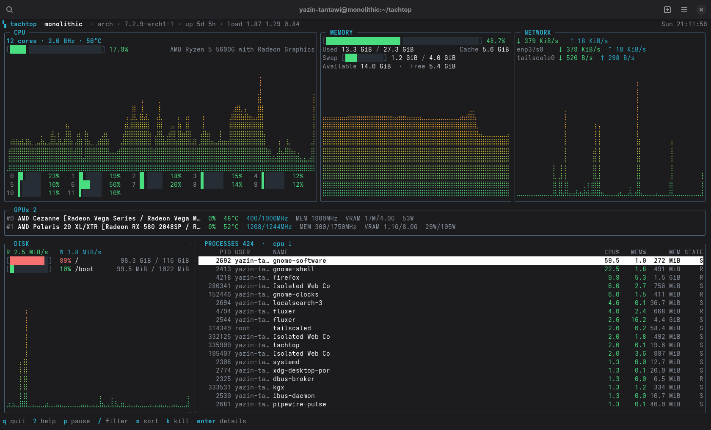

# tachtop

[](https://github.com/Orizon-Software-Foundation/tachtop/actions/workflows/ci.yml)





`tachtop` is an all-in-one interactive systems monitor, similar to btop(++), allowing you to observe many aspects of your system in real time. It requires little to no dependencies, as it is very light, allowing you to go from compilation to resource observation very quickly.

The name `tachtop` mainly is an acronym for "**Tach**yon **Top**logical Viewer", getting inspiration from the Tachyon particle, which travels faster than the speed of light.

`tachtop` allows you to observe the following system statistics in real time:

- **CPU**: Total CPU usage, core-specific usages, CPU speed, temperature, power draw, and a live graph.
- **GPU(s)**: Any and all detected DRM adapters, temperature, core speed, VRAM usage, and power draw (if allowed by vendor).
- **RAM**: Total, free, used, in use, cache, and swap/ZRAM.
- **Network**: LAN/WLAN download and upload speeds with a graph, including network name.
- **Disk**: Read/write speeds and activity, total, used, free, and in use.
- **Processes**: CPU usage, memory used, user, state, and RSS; sort, filter, inspect, and terminate processes within the same window.

`tachtop` allows you to adjust and tweak the theme using a JSON config system, making it specially tailored for your needs.

## Requirements:
- Linux (data comes from `/proc` and `/sys`).
- A terminal of at least **64×22** cells.
- Go **1.27.1 or newer** to build from source.

## Installation & Compilation:
For fast and easy compilation:
```sh
git clone https://github.com/Orizon-Software-Foundation/tachtop.git
cd tachtop
make
./tachtop
```

Or with plain Go:

```sh
CGO_ENABLED=0 go build -o tachtop ./cmd/tachtop
```

Install system-wide:

```sh
sudo make install            # /usr/local/bin/tachtop
sudo make install-desktop    # application menu entry
```

`make install` honors `PREFIX` and `DESTDIR`, for example:

```sh
make install PREFIX="$HOME/.local"
make install PREFIX=/usr DESTDIR=/tmp/pkg
```

## Usage

```sh
tachtop
```
or 
```sh
./tachtop
```
if not in PATH

Simple as that. Press `?` inside tachtop for the full key list.


## License

Licensed under the European Union Public Licence v. 1.2 (EUPL-1.2).
See [LICENSE](LICENSE).
